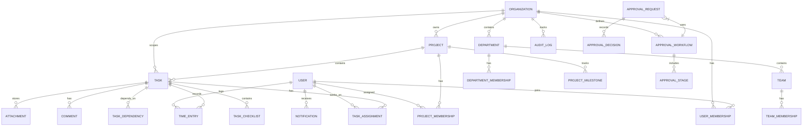
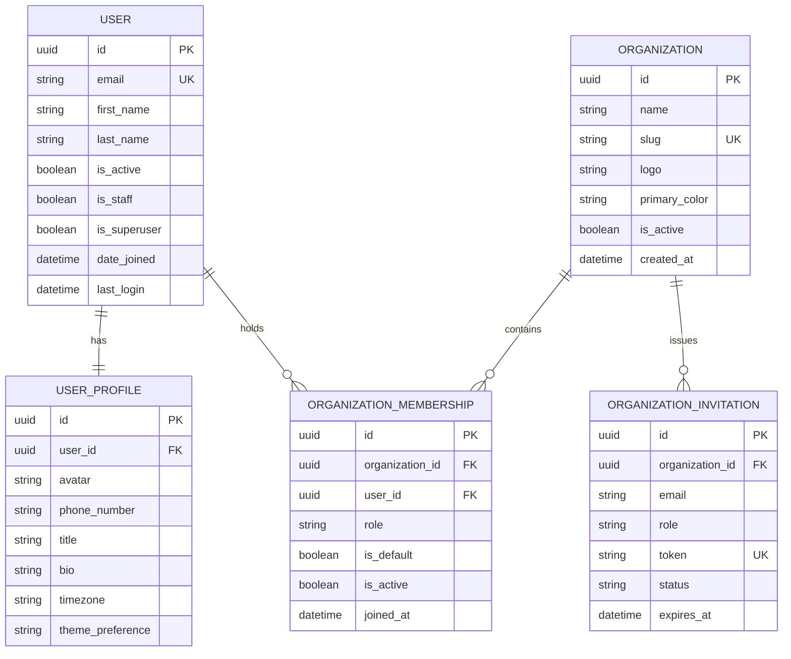
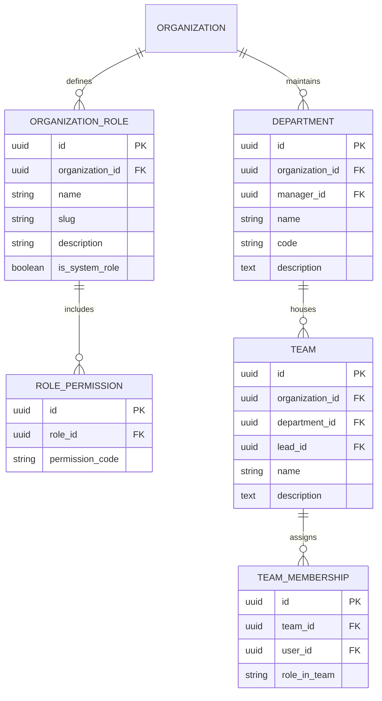
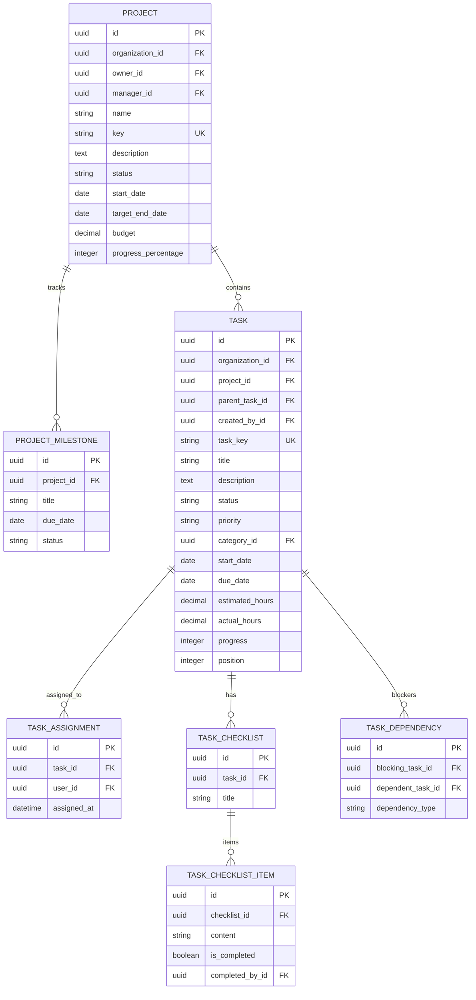
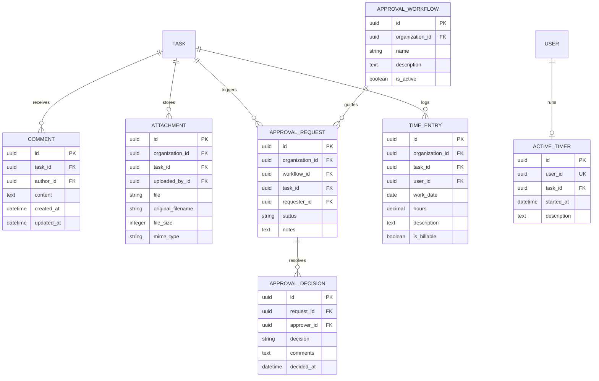

# WorkFlow Enterprise — Complete Entity-Relationship (ER) Model

This document outlines the entity relationships across all 15 modular applications.

## High-Level Domain Model Diagram

---

## Detailed Data Model Specifications by Module

### 1. Accounts & Multi-Tenancy (`apps/accounts`, `apps/organizations`)

### 2. RBAC & Organization Structure (`apps/rbac`, `apps/departments`)

### 3. Projects & Advanced Tasks (`apps/projects`, `apps/tasks`)

### 4. Collaboration, Approvals & Time Tracking (`apps/collaboration`, `apps/approvals`, `apps/time_tracking`)

---

## 5. Security & Isolation Invariants

1. **Organization Scoping:** Every business entity contains `organization_id` as non-nullable foreign key with index, except for global accounts and platform superusers.
2. **Compound Unique Constraints:** Keys such as `(organization_id, task_key)` and `(organization_id, project_key)` ensure uniqueness within an enterprise boundary without cross-tenant collisions.
3. **Cascading Strategies:** Deleting an organization cascades deletions across its sub-entities; soft-deactivation flags (`is_active = False`) are used for business operations to preserve audit trails.

